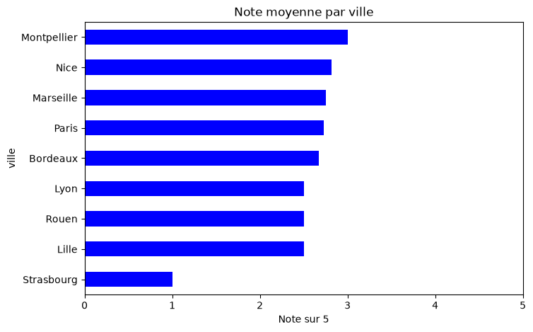
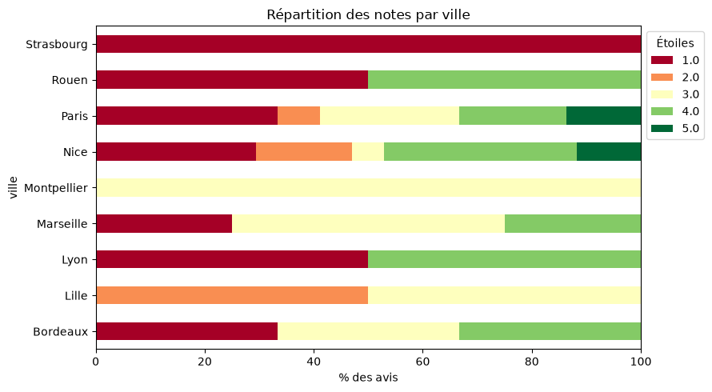
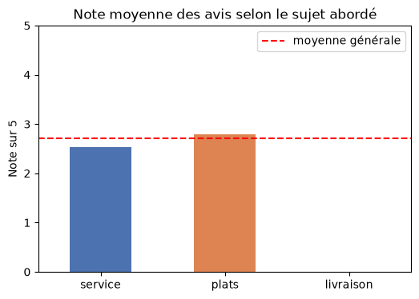
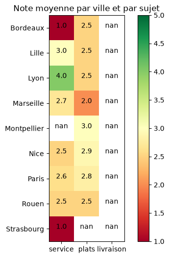
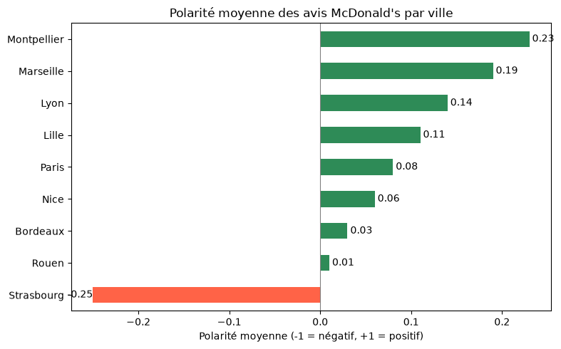
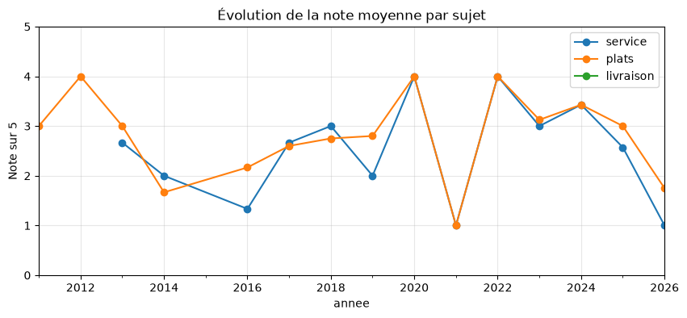
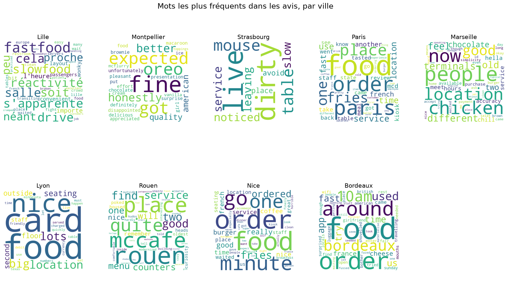

# 🍔 Yelp Scraping — Que pensent les clients de McDonald's en France ?

Projet de **web scraping** et d'**analyse de données** : collecte automatique des avis Yelp de restaurants McDonald's dans 9 grandes villes françaises, stockage en base SQLite, puis analyse des notes et du texte des avis (sentiment, thèmes, évolution).


---

## 📌 En bref

| | |
|---|---|
| **Source** | [Yelp.fr](https://www.yelp.fr) |
| **Cible** | Restaurants McDonald's |
| **Villes** | Paris, Lyon, Marseille, Nice, Bordeaux, Lille, Rouen, Montpellier, Strasbourg |
| **Volume** | 45 restaurants trouvés · 25 avec avis · **85 avis analysés** (2010 → 2026) |
| **Outils** | Selenium · SQLite · pandas · TextBlob · langdetect · matplotlib · WordCloud |

**Résultat principal :** la satisfaction est **faible partout** (2,7/5 en moyenne, un tiers des avis à 1 étoile), et c'est **le service** (accueil, attente) qui pèse le plus sur les notes.

---

## 🎯 Questions étudiées

1. **Où** les clients sont-ils le plus / le moins satisfaits ?
2. **De quoi** se plaignent-ils : service, plats ou livraison ?
3. **Comment** la satisfaction évolue-t-elle dans le temps ?

---

## 🔄 Démarche

```
 Yelp.fr ──► Selenium ──► SQLite (.db) ──► CSV ──► pandas + TextBlob ──► Graphiques & conclusions
           (scraping)    (stockage)              (nettoyage & analyse)
```

1. **Collecte** — Pour chaque ville, recherche « macdo » sur Yelp, sélection des fiches McDonald's, puis récupération de l'adresse et de chaque avis (note, date, texte) sur toutes les pages.
2. **Stockage** — Enregistrement dans une base SQLite avec une contrainte d'unicité pour pouvoir relancer le scraping sans doublons, puis export CSV.
3. **Qualité des données** — Repérage des doublons et valeurs manquantes.
4. **Analyse** — Notes par ville, analyse de sentiment (polarité et subjectivité), thèmes abordés par mots-clés, nuages de mots, évolution par année.

---

## 📊 Résultats et interprétation

### 1. Une satisfaction faible et générale

| Indicateur | Valeur |
|---|---|
| Note moyenne | **2,7 / 5** |
| Avis à 1 étoile | **33 %** (28 / 85) |
| Avis négatifs (1–2 ★) | **42 %** |
| Avis positifs (4–5 ★) | **35 %** |

Aucune ville ne dépasse **3/5** : l'insatisfaction ne vient pas d'un restaurant ou d'une ville en particulier, elle est **générale**.

<p align="center"></p>

Les notes sont **polarisées** : beaucoup de 1 étoile, peu de 5 étoiles (seulement à Paris et à Nice). Les clients sont soit très déçus, soit « moyennement » satisfaits.

<p align="center"></p>

### 2. Le service est le premier irritant

On classe chaque avis selon les thèmes qu'il aborde (mots-clés en français et en anglais) :

| Thème | Nb d'avis concernés | Note moyenne |
|---|---|---|
| **Service** (accueil, attente, personnel…) | 43 | **2,53** ⬇️ |
| **Plats** (burger, frites, goût, qualité…) | 63 | 2,79 |
| **Livraison** | 0 | — |
| *Tous les avis* | *85* | *2,71* |

➡️ Quand un client parle du **service**, c'est le plus souvent pour s'en plaindre : ces avis sont **sous la moyenne**. La **livraison** n'apparaît dans aucun avis : sur Yelp, les clients décrivent leur expérience **en restaurant**.

<p align="center"> </p>

Dans les avis négatifs, service et plats sont presque toujours cités ensemble. À **Nice**, 88 % des avis négatifs évoquent le service ; à **Paris**, ce sont plutôt les plats (67 %).

### 3. Le texte est plus nuancé que la note

La **polarité** mesure le ton du texte de -1 (très négatif) à +1 (très positif).

<p align="center"></p>

- Toutes les villes sont **proches de 0** (ton neutre à légèrement positif), alors que les notes sont faibles.
- Explication : les clients **nuancent** (« personnel sympa **mais** 20 min d'attente ») et l'outil comprend mal l'ironie.
- La **subjectivité** moyenne (0,4 à 0,6) montre des avis qui mêlent **faits** et **ressentis** : ce sont des avis argumentés.

### 4. Pas d'amélioration dans le temps

<p align="center"></p>

- Note moyenne : **2,68 avant 2020** contre **2,73 depuis 2020** → stable.
- La courbe est irrégulière car certaines années ne comptent que 1 à 3 avis.
- Signal à surveiller : les avis sur le **service** chutent en 2025–2026.

### Mots les plus fréquents par ville

<p align="center"></p>

---

## ⚠️ Limites

- **Petit échantillon** : 85 avis, dont **60 % à Paris**. Pour Montpellier et Strasbourg (1 avis chacune), les résultats sont seulement indicatifs.
- **Biais de sélection** : les clients mécontents laissent plus souvent un avis.
- **Sentiment « simple »** : TextBlob s'appuie sur un dictionnaire de mots et gère mal l'ironie ou les phrases mixtes.
- **Thèmes par mots-clés** : un avis peut être mal classé.
- **Zone de recherche ≠ commune** : Yelp inclut des restaurants de communes voisines (ex. Villeneuve-d'Ascq pour Lille).
- **Doublons techniques** : les restaurants sans avis apparaissent plusieurs fois dans la base (en SQL, deux valeurs vides ne sont jamais « égales », donc la contrainte d'unicité ne les bloque pas). Les analyses portent uniquement sur les 85 vrais avis.

## 🚀 Pistes d'amélioration

- Collecter davantage d'avis (plus de villes, Google Maps, TripAdvisor).
- Utiliser un modèle de sentiment plus performant pour le français (ex. CamemBERT).
- Comparer McDonald's avec d'autres enseignes de restauration rapide.

---

## 📁 Structure du projet

```
YELP_SCRAPING/
├── README.md                          ← vous êtes ici
├── requirements.txt                   ← librairies Python nécessaires
├── notebooks/
│   └── projet_scraping_mcdo.ipynb     ← scraping + analyse, commenté pas à pas
├── data/
│   ├── mcdo_yelp.db                   ← base SQLite (table avis_bruts)
│   └── mcdo_avis.csv                  ← même données au format CSV
└── figures/                           ← graphiques utilisés dans ce README
```

### Description des données

| Colonne | Description | Exemple |
|---|---|---|
| `id` | Identifiant unique de la ligne | `1` |
| `ville` | Ville de recherche sur Yelp | `Lille` |
| `url` | Lien de la fiche Yelp du restaurant | `https://www.yelp.fr/biz/mcdonalds-lille-6` |
| `adresse` | Adresse du restaurant | `10 place de Béthune 59800 Lille` |
| `date` | Date de l'avis (AAAA-MM-JJ) | `2023-12-16` |
| `note` | Note de 1 à 5 étoiles | `2` |
| `avis` | Texte de l'avis | `fastfood qui s'apparente à une slowfood…` |

---

## ▶️ Reproduire le projet

```bash
# 1. Cloner le dépôt
git clone https://github.com/Ornella2005-coder/YELP_SCRAPING.git
cd YELP_SCRAPING

# 2. Installer les librairies
pip install -r requirements.txt

# 3. Télécharger les données linguistiques de TextBlob (une seule fois)
python -m textblob.download_corpora

# 4. Ouvrir le notebook
jupyter notebook notebooks/projet_scraping_mcdo.ipynb
```

- **Pour refaire seulement l'analyse** : exécutez le notebook à partir de la partie **3. Qualité des données** (les données sont déjà dans `data/`).
- **Pour relancer le scraping** : Google Chrome doit être installé. Yelp modifie régulièrement son site, il faudra peut-être adapter les sélecteurs XPath.

---

## ⚖️ Note sur le scraping

Projet réalisé à des **fins pédagogiques**. Les avis appartiennent à leurs auteurs et à Yelp ; respectez les [conditions d'utilisation de Yelp](https://www.yelp.fr/static?p=tos) et limitez la fréquence des requêtes (des pauses de 4 secondes sont prévues dans le code).
